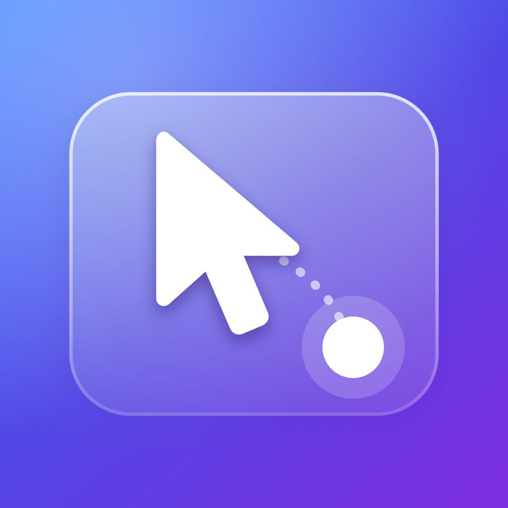

<p align="center"></p>

# Couchpad

Use your iPhone as a trackpad, keyboard and media remote for your Mac – from bed, the couch, or across the room.

- **Trackpad:** smooth pointer, tap / double-tap / two-finger right-click, two-finger scroll, hold to drag
- **Keyboard:** type on the iPhone and it appears on the Mac; Esc, Tab, arrows and common shortcuts
- **Media:** volume slider and mute, brightness, play/pause/next/previous, lock or sleep the display
- **Screen Mirroring:** start or stop AirPlay mirroring to your TV from the iPhone
- **Presentation mode:** big Next/Back buttons, start slideshow, black screen and a timer (Keynote, PowerPoint, Google Slides)
- **Apps:** see the Mac's open apps with their icons; switch to, open or quit them
- **Clipboard:** send text to the Mac's clipboard, or get the Mac's clipboard on the iPhone
- **Secure:** only iPhones you pair can control the Mac, everything is end-to-end encrypted, plus optional Face ID lock and per-connection approval

| Part | Folder | |
|---|---|---|
| iPhone app | `iOS/MacRemote` | target **Couchpad** in `Couchpad.xcodeproj` |
| Mac app | `MacServer/Sources/MacRemoteServer` | target **Couchpad Mac** (App Store, sandboxed), or `MacServer/make-app.sh` (development build) |
| Shared security + protocol | `MacServer/Sources/RemoteCore` | used by both, with tests in `MacServer/Tests` |

---

## Quick start (on your own devices)

You need a Mac with **Xcode 16 or newer** and an iPhone with iOS 17+.

1. **Settings, once:** open `Config/Shared.xcconfig` and set `BUNDLE_ID_PREFIX` to something unique like `com.yourname` (and `DEVELOPMENT_TEAM` if you have a developer account – otherwise pick your Apple ID as the team in Xcode).
2. Open **`Couchpad.xcodeproj`**.
3. **Mac:** choose the **Couchpad Mac** scheme → My Mac → **▶︎**. Click **Turn On**, and allow **Accessibility** when asked (System Settings → Privacy & Security → Accessibility → Couchpad).
4. **iPhone:** choose the **Couchpad** scheme → your iPhone → **▶︎**.
5. **Pair:** on the Mac click **Pair iPhone…**. On the iPhone tap **Scan Pairing Code** and point it at the QR code (or point the iPhone's Camera app at it, or tap the Mac in the list and type the 6-digit code).

That's it – from now on the iPhone connects to the Mac automatically.

> With a free Apple ID, apps you install from Xcode stop opening after 7 days; press ▶︎ again to renew. Apps from the App Store don't have this limit.

### Development build of the Mac app (no Xcode project needed)

```bash
cd MacServer
./make-app.sh          # builds Couchpad.app into /Applications and opens it
```

This version isn't sandboxed, so it also has a 0–100% **brightness slider** and **Sleep Display**, which the App Store version can't offer (the iPhone shows −/+ brightness and Lock Screen instead).
Or run it in Terminal: `swift run -c release` (add `--pair` to pair, `--help` for options).

---

## Publishing on the App Store

Everything technical is set up: app icons (including iOS dark and tinted variants), privacy manifests, sandbox entitlements, Info.plist permission texts, a Mac build without private frameworks, and a support + privacy website in `docs/` for GitHub Pages.

A VPN is intentionally not included; see [`AppStore/VPN-PLAN.md`](AppStore/VPN-PLAN.md) for what it would take.

**Follow [`AppStore/SUBMITTING.md`](AppStore/SUBMITTING.md)** – it walks through the Apple Developer account, App Store Connect, uploading and review. Listing text is in [`AppStore/Metadata.md`](AppStore/Metadata.md), review notes in [`AppStore/ReviewNotes.md`](AppStore/ReviewNotes.md) and the privacy policy in [`AppStore/PRIVACY.md`](AppStore/PRIVACY.md).

---

## Security

The old version accepted a 6-digit PIN sent in plain text. Couchpad replaces it with pairing and end-to-end encryption (`MacServer/Sources/RemoteCore/SecureSession.swift`):

- **Pairing only from the Mac's screen.** Pairing is possible only while someone clicks *Pair iPhone…* on the Mac (3 minutes, 5 wrong tries). The QR code carries a 256-bit secret; the 6-digit code is the fallback.
- **Key exchange.** Both devices do an X25519 key exchange and prove they know the secret with HMAC-SHA256 over everything exchanged. The Mac then gives the iPhone a random 256-bit pairing key, encrypted. The iPhone stores it in the Keychain (this device only); the Mac in its private app storage.
- **Every connection.** A fresh X25519 exchange; both sides prove they hold the pairing key. A stranger on your Wi-Fi can't control the Mac, and a fake "Mac" can't trick your iPhone into sending it what you type.
- **Every message.** Session keys are derived per connection (forward secrecy). All commands – over TCP and the fast UDP channel for pointer movement – are sealed with ChaChaPoly and numbered, so they can't be read, changed, replayed or reordered.
- **Brute-force protection.** Repeated failures lock out new connections for a minute.
- **Locked Mac stays locked.** While the Mac's screen is locked it ignores the trackpad, keyboard, apps and clipboard from phones (volume and playback still work), so nobody can type at the login window.
- **Optional extras.** *Ask before each connection* (Mac shows Allow / Don't Allow), *QR-only pairing* (turn off the 6-digit code), and *Require Face ID* on the iPhone.
- **Nothing leaves your network.** No accounts, servers, analytics or tracking.

Forget a pairing on the iPhone in **Settings → Paired Macs** (swipe left) or on the Mac in **Paired iPhones** (trash icon).

---

## How it connects

The iPhone finds the Mac with Bonjour (`_couchpad._tcp`) on the same Wi-Fi. Pointer movement and scrolling travel over UDP so a lost Wi-Fi packet never makes the pointer stutter; everything else uses TCP. If discovery doesn't work you can connect by IP address (port 51515). An optional direct (AirDrop-style) connection works without a shared network but can add lag.

## Troubleshooting

- **The iPhone doesn't see the Mac:** make sure Couchpad on the Mac is turned on and both are on the same Wi-Fi. Check iPhone Settings → Privacy & Security → **Local Network** → Couchpad is on.
- **Connected but the pointer doesn't move:** turn on **Couchpad** under System Settings → Privacy & Security → **Accessibility** on the Mac. (In the App Store version macOS may also ask to allow it to control the computer.)
- **"Doesn't recognize this iPhone":** the pairing was removed on the Mac; pair again.
- **Screen Mirroring can't find the menu:** keep the Screen Mirroring icon in the menu bar (System Settings → Control Center → Screen Mirroring → *Always Show in Menu Bar*). `swift run -c release MacRemoteServer --dump-menubar Mirroring` shows what Couchpad can see.
- **Laggy pointer:** stay on the same 5 GHz Wi-Fi with *Direct connection* off.

## Project layout

```
Couchpad.xcodeproj           iPhone app + Mac App Store app
Config/Shared.xcconfig       team id, bundle id prefix, version (edit this)
AppStore/                    submission guide, listing text, review notes, privacy policy, VPN plan
docs/                        website for GitHub Pages: home, support, privacy
Design/Icon/                 icon sources (SVG) – render with `node render.js in.svg out.png 1024`
iOS/
  Info.plist                 permission texts, Bonjour service, couchpad:// link
  MacRemote/                 iPhone app (SwiftUI) + Assets.xcassets + PrivacyInfo.xcprivacy
MacServer/
  Package.swift              command-line / development build and tests
  Sources/RemoteCore/        protocol, pairing and encryption (shared)
  Sources/MacRemoteServer/   Mac app: server, input, volume, brightness, mirroring, window, menu bar
  Resources/                 Mac asset catalog + privacy manifest
  AppStore/                  Mac Info.plist + sandbox entitlements
  Tests/RemoteCoreTests/     security tests
  make-app.sh                development Couchpad.app
.github/workflows/build.yml  CI: tests + builds + App Store checks on macOS
```
