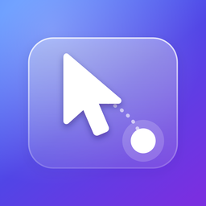

**Couchpad** turns your iPhone into a trackpad, keyboard and remote for your Mac – for when your Mac is plugged into a TV, or you're watching from bed or the couch.

- **Trackpad & keyboard:** smooth pointer, clicks, scrolling, dragging, typing and shortcuts
- **Media:** volume, mute, play/pause, next/previous, brightness, lock screen
- **Screen Mirroring:** start AirPlay mirroring to your TV from your iPhone
- **Presentation mode:** next/previous slide, start, black screen and a timer
- **Apps:** switch between, open and quit apps on your Mac
- **Clipboard:** send text to your Mac's clipboard or get the Mac's clipboard on your iPhone
- **Private and secure:** pair once by scanning a code on your Mac; everything is end-to-end encrypted; nothing leaves your home network

You need **Couchpad** on your iPhone (iOS 17+) and **Couchpad Receiver** on your Mac (macOS 13+), both free.

[Support](support) · [Privacy Policy](privacy)
